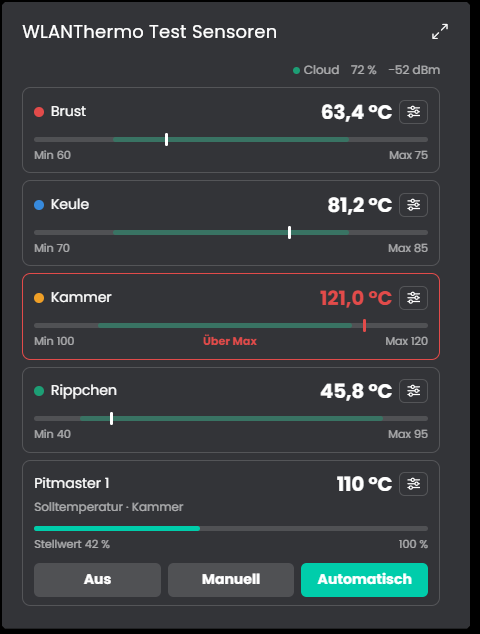
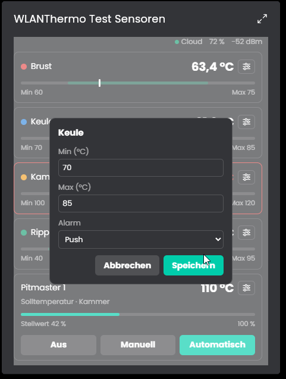
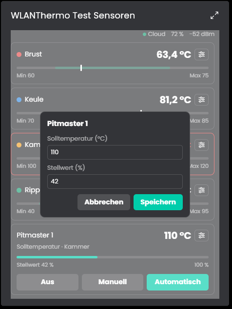

# WLANThermo
Dieses Modul verbindet WLANThermo (ESP32 und Nano V1) per MQTT mit IP-Symcon. Es liest Kanäle, Pitmaster und Systemwerte, ändert sie über das Gerät und zeigt alles in einer Kachel.

## Inhaltsverzeichnis
- [WLANThermo](#wlanthermo)
  - [Inhaltsverzeichnis](#inhaltsverzeichnis)
  - [Screenshots](#screenshots)
  - [1. Voraussetzungen](#1-voraussetzungen)
  - [2. Funktionsumfang](#2-funktionsumfang)
  - [3. Enthaltene Module](#3-enthaltene-module)
  - [4. Installation](#4-installation)
  - [5. Konfiguration in IP-Symcon](#5-konfiguration-in-ip-symcon)
  - [6. Spenden](#6-spenden)
  - [7. Lizenz](#7-lizenz)

## Screenshots

Kachel mit Kanälen und Pitmaster:

Alarmgrenzen und Alarmart eines Kanals ändern:

Solltemperatur und Stellwert des Pitmasters ändern:

## 1. Voraussetzungen

* mindestens IPS Version 9.0
* WLANThermo mit MQTT (ESP32-Modelle oder Nano V1/V1+)
* MQTT Server oder MQTT Client in IP-Symcon, an den das WLANThermo sendet

## 2. Funktionsumfang

* Kanäle mit Temperatur, Alarmgrenzen, Alarmart, Name, Farbe und Fühlertyp
* Pitmaster mit Modus, Stellwert, Solltemperatur, Kanal und PID-Profil
* System-Einstellungen und PID-Profile des Geräts ändern
* Kachel für die Kachel-Visualisierung mit Temperaturbalken, Alarmanzeige und Pitmaster

Die einzelnen Funktionen stehen bei der Instanz unter "Enthaltene Module" und in der README des Moduls.

## 3. Enthaltene Module

* [WLANThermo](WLANThermo/README.md)
  * Verbindet ein WLANThermo per MQTT mit IP-Symcon und legt Variablen für Kanäle, Pitmaster und Systemwerte an.
  * Die Instanz hat eine Kachel für die Kachel-Visualisierung.
  * Die Instanz wird manuell angelegt, das MQTT Topic ist der Hostname des Geräts.

## 4. Installation

Die Installation erfolgt über den IP-Symcon Module Store.

## 5. Konfiguration in IP-Symcon

Zuerst muss das WLANThermo MQTT an einen MQTT Server in IP-Symcon senden. Danach wird die Instanz "WLANThermo" angelegt und als MQTT Topic der Hostname des Geräts eingetragen. Die Variablen entstehen, sobald das Gerät Daten sendet. Die Einzelheiten stehen in der README des Moduls.

## 6. Spenden

Dieses Modul ist für die nicht kommerzielle Nutzung kostenlos, Schenkungen als Unterstützung für den Autor werden hier akzeptiert:

 

## 7. Lizenz

[CC BY-NC-SA 4.0](https://creativecommons.org/licenses/by-nc-sa/4.0/)
